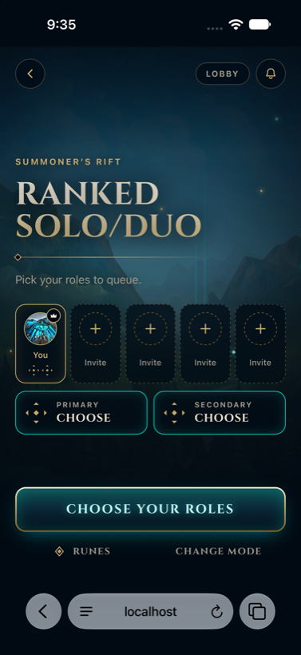
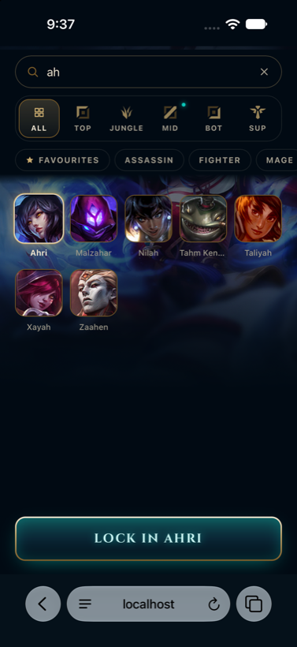
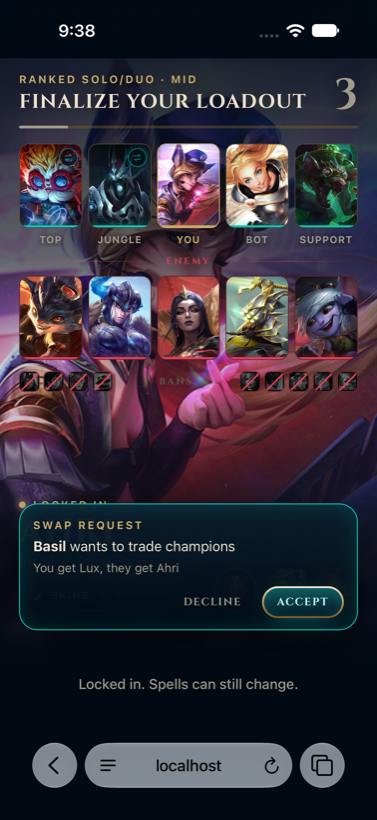
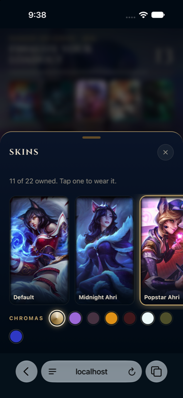

<div align="center">


# Hover

**League of Legends champ select from your phone.**

Queue up, accept the match, ban, pick, lock in, trade picks and set your runes, all from your phone, without walking back to your desk.

### [⬇ Download for Mac](https://github.com/Luqman-Ismat/hover/releases/latest/download/Hover-mac.zip) &nbsp;·&nbsp; [⬇ Download for Windows](https://github.com/Luqman-Ismat/hover/releases/latest/download/Hover-windows.zip)

Free · No account needed · Nothing to install on your phone

<br>

 &nbsp;
 &nbsp;
 &nbsp;


</div>

---

## What you can do

- 🎮 **Lobby:** pick a game mode, invite friends, accept party invites and choose your roles.
- ✅ **Queue:** find a match and accept it when it pops.
- ⚔️ **Champ select:** ban, pick and lock in. Search champions and filter by lane, class or favourites (press and hold a champion to make it a favourite). Your champion's splash art fills the screen in the skin you picked.
- 🔁 **Trades:** swap picks or positions with teammates, and accept their offers.
- 🎨 **Loadout:** choose your skin and chroma, change summoner spells, and switch or edit rune pages.
- 🔔 **Alerts:** your phone buzzes for party invites, match found, your turn to pick or ban, when 10 seconds are left, and when the game has loaded. It can even notify you when your phone is locked (see [step 4](#step-4-optional-get-notifications-when-your-phone-is-locked)).

---

## What you need

- A **Mac or Windows PC** that you play League on.
- An **iPhone** (Android phones with Chrome should work too, but haven't been tested much).
- Your phone and computer on the **same Wi‑Fi network**.

---

## Set it up (about 2 minutes)

### Step 1: Download Hover on your computer

| Mac | Windows |
|---|---|
| [**Download Hover for Mac**](https://github.com/Luqman-Ismat/hover/releases/latest/download/Hover-mac.zip) | [**Download Hover for Windows**](https://github.com/Luqman-Ismat/hover/releases/latest/download/Hover-windows.zip) |
| 1. Open your **Downloads** folder and double‑click **Hover-mac.zip** to unzip it. | 1. Open your **Downloads** folder, right‑click **Hover-windows.zip** and choose **Extract All… → Extract**. (Don't run it from inside the zip.) |
| 2. Drag **Hover** into your **Applications** folder. | 2. Open the new **Hover** folder and double‑click **Hover.exe**. |
| 3. Double‑click **Hover** to open it. | |

### Step 2: Get past the security warning (first time only)

Hover is free and isn't registered with Apple or Microsoft. Registration costs a yearly fee, so your computer will warn you the first time you open it. This happens once.

<details>
<summary><b>On a Mac: “Hover” Not Opened / Apple could not verify…</b></summary>

1. Click **Done** on the warning (don't move it to the Bin).
2. Open **System Settings → Privacy & Security**.
3. Scroll down to the message about Hover and click **Open Anyway**. Enter your Mac password if it asks.
4. Click **Open Anyway** once more.

If your Mac says **“Hover is damaged and can't be opened”**, open the **Terminal** app, paste this line and press Return. Then open Hover again:

```bash
xattr -cr /Applications/Hover.app
```

If your Mac asks whether Hover can **accept incoming network connections**, click **Allow**. That's how your phone talks to it.
</details>

<details>
<summary><b>On Windows: “Windows protected your PC”</b></summary>

1. Click **More info**.
2. Click **Run anyway**.

When **Windows Firewall** asks about Hover, tick **Private networks** and click **Allow access**. That's how your phone talks to it.
</details>

### Step 3: Connect your phone

1. Hover opens a window with a **QR code**.
2. On your phone, open the **Camera** and point it at the QR code. Tap the link that appears.
3. That's it, you're connected. You only do this once.

**Tip: make it an app.** In Safari, tap the **Share** button (the square with an arrow) → **Add to Home Screen** → **Add**. Hover gets its own icon and opens full‑screen.

Open League whenever you like; Hover finds it by itself.

### Step 4 (optional): Get notifications when your phone is locked

Want a buzz when the match pops while your phone is in your pocket?

1. In Hover on your phone, tap the **bell 🔔** at the top.
2. Turn on **Alerts with Hover closed**.
3. Follow the three short steps it shows you: get the free **ntfy** app, paste in your code, and tap **Send a test**.

---

## Everyday use

- **Closing the Hover window doesn't turn it off.** It keeps running quietly in the **menu bar** (Mac, top right of the screen) or the **system tray** (Windows, bottom right; click the **^** arrow if you don't see it).
- Click the Hover icon there to **show the QR code again**, turn on **Start Hover at login** so it's always ready, or **Quit Hover**.
- Just open Hover on your phone whenever you want to use it.

---

## Help

<details>
<summary><b>My phone says it can't connect</b></summary>

- Make sure your phone is on the **same Wi‑Fi** as your computer (not on mobile data, and not on a “guest” network).
- Check that Hover is running on your computer: look for its icon in the menu bar or tray.
- On Windows, the firewall may have blocked it. Open **Windows Security → Firewall & network protection → Allow an app through firewall** and make sure **Hover** is ticked for **Private**.
- If your Wi‑Fi changed, scan the QR code again (click the Hover icon → show the QR code).
</details>

<details>
<summary><b>It says it's waiting for League</b></summary>

Open the League of Legends client and log in. Hover connects as soon as the client is running.
</details>

<details>
<summary><b>Something didn't work in champ select</b></summary>

Riot changes the League client often, so things can break after a patch. Please [open an issue](https://github.com/Luqman-Ismat/hover/issues) and say what you tapped and what happened. It also helps to attach Hover's log file:

- **Mac:** in Finder press **⇧⌘G**, paste `~/.hover/hover.log` and press Return.
- **Windows:** press **Win + R**, paste `%USERPROFILE%\.hover\hover.log` and press Enter.
</details>

<details>
<summary><b>How do I disconnect my phone or uninstall Hover?</b></summary>

- **Disconnect all phones:** delete the file `devices.json` in the `.hover` folder (see the paths above), then restart Hover.
- **Uninstall:** quit Hover from its menu bar or tray icon, then delete the app (Mac: drag **Hover** from Applications to the Bin; Windows: delete the **Hover** folder). To remove its settings too, delete the `.hover` folder in your home folder.
</details>

<details>
<summary><b>Is this safe? Will I get banned?</b></summary>

- Hover only does something when **you tap a button**. It never auto‑accepts, auto‑picks or auto‑locks, and it doesn't touch the game itself, only the League client's menus.
- It uses the League client's own local connection, the same one many popular companion apps use. Riot doesn't officially support it, though, so use it at your own risk.
- Only phones that scanned your QR code (or typed the 6‑digit code shown on your computer) can control it. Everything stays on your home Wi‑Fi; nothing goes through a Hover server.
- Don't use Hover on public or untrusted Wi‑Fi.
- League client apps like this aren't allowed in Korea.
</details>

---

## For developers

Hover is a small Node.js bridge plus a phone web app, packaged as an [Electron](https://www.electronjs.org) desktop app.

```
Phone (Safari / home‑screen app)  ⇄  Wi‑Fi  ⇄  Hover on your computer  ⇄  League client
```

```bash
npm install
npm run app     # the desktop app (window + menu bar / tray) from source
npm start       # just the bridge, in a terminal, against the real client
npm run dev     # a mock League client + Hover, no League needed
npm test        # end-to-end test against the mock
npm run build   # dist/Hover-mac.zip and dist/Hover-windows.zip (run on a Mac)
```

The mock (`mock/lcu.js`) simulates the client: friends and invites, a ranked draft with bot teammates and opponents, swap requests, ARAM, rune pages and the in‑game API. It pulls game data and art from CommunityDragon. Set `MOCK_SPEED=4` to run it faster.

**How it fits together**

- `bridge/lcu.js` reads the client's credentials and talks to its local HTTPS API and event WebSocket.
- `bridge/state.js` mirrors the lobby, party, queue, ready check, champ select, rune pages and live game. It turns phone intents (`hover`, `lock`, `swap`, `runeSave`, …) into client calls. The phone can't send arbitrary endpoints.
- `bridge/index.js` handles pairing, serves the web app, proxies game art (including each skin's splash), sends notifications and runs the phone's WebSocket.
- `web/roles/` holds League's own position icons; `scripts/icons.py` draws Hover's app, tray and home-screen icons.
- `web/` is a Preact app with no build step.
- `desktop/main.js` is the desktop app: it runs the bridge, shows the Connect window and keeps Hover in the menu bar or system tray.

**Security**

- Pairing needs the 6‑digit code shown on the computer (the QR code includes it). It changes every launch, with 5 tries per minute.
- A paired phone gets a long random token in an HttpOnly cookie; only its hash is stored, in `~/.hover/devices.json`.
- The phone socket checks the token and the origin, and only allowlisted, validated commands reach the client.
- Traffic is plain HTTP on the local network. Notifications for a locked phone go through [ntfy.sh](https://ntfy.sh) on a random topic and only say things like “Match found”.

**Notes**

- The apps aren't signed with an Apple or Microsoft developer certificate, which is why the first launch shows a warning.
- The League Client API is unofficial and can change with any patch. Hover takes no action on its own, in line with Riot's third‑party app policy.

Contributions and bug reports are welcome. [Open an issue](https://github.com/Luqman-Ismat/hover/issues).

## License

[MIT](LICENSE)

---

<sub>Hover isn't endorsed by Riot Games and doesn't reflect the views or opinions of Riot Games or anyone officially involved in producing or managing Riot Games properties. Riot Games and all associated properties are trademarks or registered trademarks of Riot Games, Inc.</sub>
